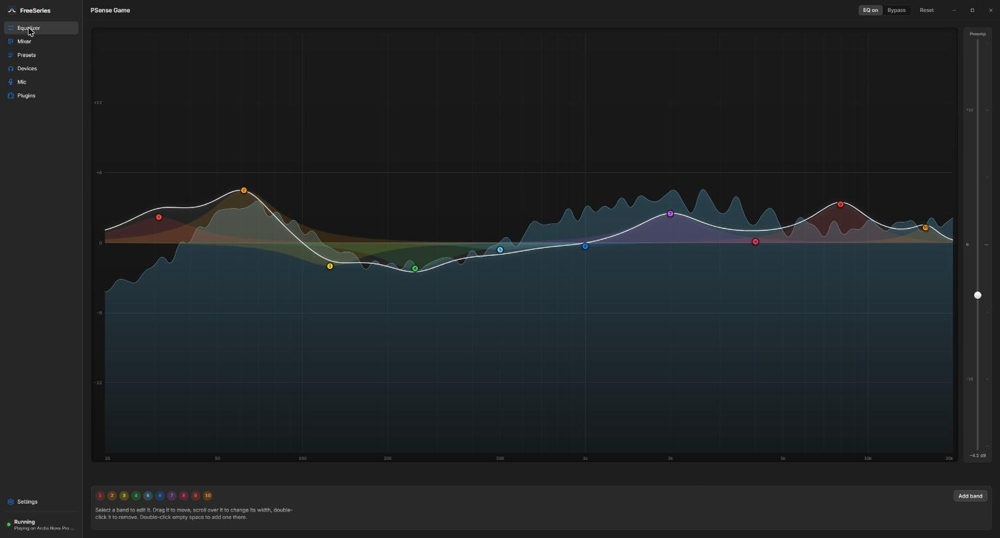
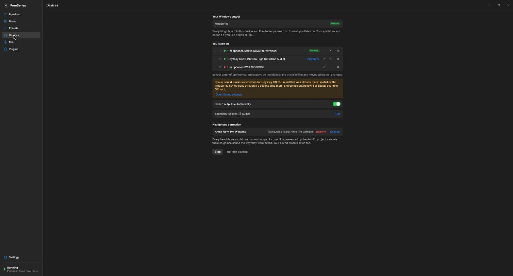

# FreeSeries

A free, open-source alternative to SteelSeries Sonar for Windows: a parametric EQ, a Game / Media / Chat mixer, headphone correction from AutoEq and a cleaned-up microphone. No account, no ads, no telemetry, and it works with any headset.

The one thing nobody else does: the EQ sits **after** Dolby Atmos for Headphones or DTS Headphone:X, so you keep the spatial sound you already paid for. Sonar makes you switch it off; Equalizer APO is skipped for spatial streams.



## What it does

- **Parametric EQ** on everything you hear, drawn and dragged on a live spectrum. Peak and shelf bands, preamp, soft limiter, import and export in Equalizer APO text, so Peace and AutoEq presets just work.
- **Mixer**: Game, Media and Chat channels with their own volume and EQ. Drag Discord onto Chat and Spotify onto Media; FreeSeries pins them there and puts them back after a restart.
- **Headphone correction** per output from the AutoEq database, downloaded when you pick your model. Your sound presets sit on top of it.
- **Outputs that follow you**: an ordered list of headphones and speakers. Headset off, audio moves to the monitor and its EQ; headset back, audio moves back.
- **Microphone**: noise removal (RNNoise), strength slider, a mic EQ, and "hear yourself". Discord and games read a virtual microphone called FreeSeries Mic.
- **Headset plugins**: the Arctis Nova Pro Wireless base station shows battery, mute and the dial, and its OLED can show the time, the battery and the preset you have on.
- **Tray, hotkeys, start with Windows.** Right-click the tray icon to switch outputs or presets without opening the window.
- **An AI agent can tune it.** A local MCP endpoint, off by default, lets Claude Code read the spectrum, hear the mic as a spectrum, and set the EQ with you.



## How it works

```
games and apps → "FreeSeries" virtual device (Atmos / DTS on, if you use it)
              → WASAPI loopback → Rust engine: per-channel EQ and volume, mix, correction, limiter
              → your headphones or speakers
real mic → RNNoise → EQ → VB-CABLE → "FreeSeries Mic" in Discord
```

The virtual device is FxSound's Microsoft-signed driver, unmodified, so there is no test-signing and no driver of our own. The engine is a user-mode Rust process; the window is Tauri and React, and closing it leaves the audio running in the tray. While audio runs FreeSeries is the Windows default output, and it hands the default back when it stops, quits or crashes.

Added latency, measured with `examples/latency.rs`: about 30 ms on the main channel to an Arctis Nova Pro Wireless, 20 ms to a wired monitor. The mic path is about 105 ms, most of it in the cable.

## Install

There is no release build yet. Build it from source on Windows 11:

```
# needs Rust (stable), Node 22+ and the Tauri 2 prerequisites (WebView2 ships with Windows 11)
cd app
npm install
npm run tauri build      # installer under app/src-tauri/target/release/bundle/nsis
```

Run the installer, open FreeSeries and let Setup install the virtual audio device (one admin prompt). For the microphone, install [VB-CABLE](https://vb-audio.com/Cable/) and reboot; FreeSeries renames its ends so the right one is obvious. Leave spatial sound off on your real headphones and on for the FreeSeries device.

`npm run upgrade` builds and installs a new version over the old one, keeping your settings.

## Develop

```
cargo test                       # the engine crate: EQ math, mixing, routing, headset protocol, mic
cd app && npm run check          # the UI's one runnable check: curve math, agent protocol, tray menu
cd app && npm run tauri:dev      # a "FreeSeries dev" build that runs next to the installed app
```

The layout: `src/` is the audio engine crate (`cargo run` is a CLI for it), `app/src-tauri` the Tauri shell, `app/src` the React UI, `examples/` the hardware probes and latency tools, `docs/` the decisions and measurements. Start with [docs/architecture.md](docs/architecture.md), then [docs/roadmap.md](docs/roadmap.md), which is a dated log of what was built and what is still unproven.

## Status

Used daily on one PC with an Arctis Nova Pro Wireless, a monitor and Realtek speakers. Version 0.3.0. Things that are built but not yet proven on hardware are marked in the roadmap. Other headsets need a plugin table; see [docs/headsets.md](docs/headsets.md) for how to add one.

## License

AGPL-3.0-or-later. Third-party material and its licenses are listed in [THIRD-PARTY.md](THIRD-PARTY.md): the FxSound driver, Inter, AutoEq, and the projects whose protocol notes the headset support follows.
